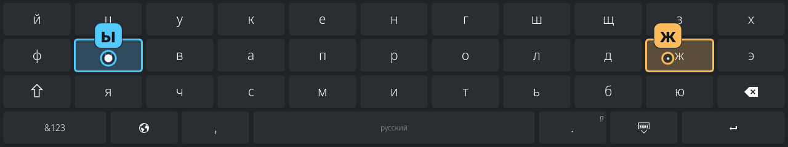
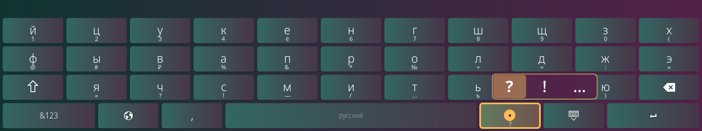
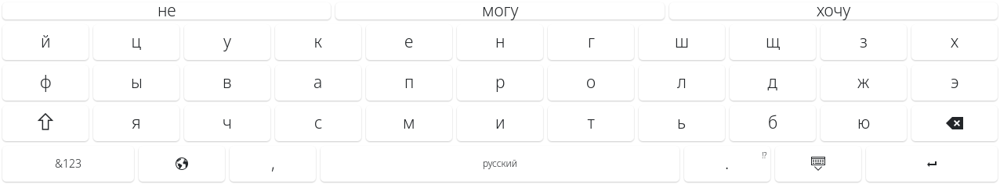
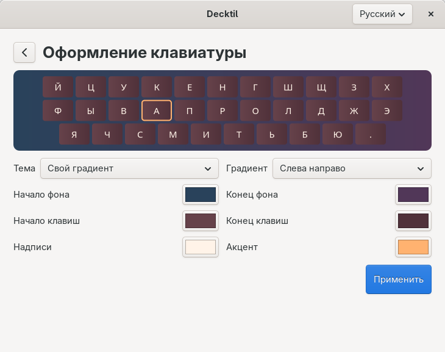

# Decktil

Decktil адаптирует экранную клавиатуру KDE Plasma для двух трекпадов Steam Deck. Одно окно настроек включает Decktil на рабочем столе KDE, в Big Picture на рабочем столе и в интерфейсе Steam в игровом режиме SteamOS. Набирайте текст с тактильным откликом и подсказками на русском и английском.

[Скачать для Steam Deck](https://github.com/YaziAranea/Decktil/releases/latest). В разделе **Assets** скачайте архив **Decktil.tar.gz**. В режиме рабочего стола распакуйте его и откройте **Decktil.desktop**. Затем менеджер можно открыть из меню приложений по названию **Decktil**.

## Игровой режим и Big Picture

Вернитесь в игровой режим SteamOS или откройте Big Picture на рабочем столе. Выберите поиск библиотеки. Decktil открывается в распознанном поле. Для ручного вызова или скрытия нажмите **Steam + X**.

| Действие | Управление |
| --- | --- |
| Ввести букву | Наведите палец и слегка прижмите трекпад. Можно также нажать соответствующий триггер **L2** или **R2** |
| Поставить пробел | Нажмите **R1** или выберите пробел на панели |
| Стереть | Нажмите **X** один раз или удерживайте для повтора. После очистки поиска можно сразу вводить новый запрос |
| Дополнить слово | В распознанном поле выберите подсказку над буквами. Попробуйте набрать «варит» и выбрать «варить» |
| Скрыть панель, сохранив запрос | Нажмите **Steam + X** |

Игровая панель предназначена для интерфейса Steam. Внутри запущенных игр и при занятом слое MangoHUD управление остаётся у приложения. Автопоказ и подсказки зависят от того, распознал ли Decktil поле ввода в текущей версии Steam. [Подробнее об игровом режиме](experimental/gaming/README.md).

## Рабочий стол KDE

| Действие | Управление |
| --- | --- |
| Открыть клавиатуру | В текстовом поле нажать **X**. Нажатие, открывшее панель, сохраняет текст и выделение. Для отдельной **X** нужно штатное назначение показа клавиатуры в настольной раскладке Steam |
| Скрыть клавиатуру и оставить текст | Нажать **B** и отпустить. Введённый текст, выделение и список подсказок браузера сохраняются. Правый трекпад снова управляет мышью. Также работают **Steam + X** и экранная клавиша скрытия |
| Навести на букву | Провести пальцем по левому или правому трекпаду. Цветная подсказка показывает выбранную клавишу |
| Ввести букву | Щёлкнуть этим трекпадом или нажать **L2** для левого, **R2** для правого, сохраняя касание |
| Ввести дополнительный символ | Навестись на букву или точку и удерживать щелчок трекпада либо его триггер 0,5 с. Сдвинуть палец в сторону нужного знака и отпустить. Без сдвига вводится символ, подписанный под клавишей |
| Стереть текст | На открытой клавиатуре нажать **X**, чтобы удалить один символ слева от курсора или выделение. Удержание запускает повтор через 450 мс, затем каждые 75 мс. Когда поле опустеет, панель закроется |
| Скрыть клавиатуру в уже пустом поле | Нажать **X**. Чтобы продолжить набор после стирания последней буквы, используйте экранную **⌫** — она оставляет панель открытой |
| Дополнить слово | Начать слово на русском или английском и выбрать подсказку сверху трекпадом или касанием |
| Исправить опечатку | До пробела выбрать в верхнем ряду нужное слово. Например, для «првиет» выбрать «привет», для `keybaord` выбрать `keyboard`. Пробел сохраняет введённое написание |
| Выбрать следующее слово | Напечатать слово и поставить пробел. Выбрать продолжение в верхнем ряду трекпадом или касанием |
| Сменить язык клавиатуры | Выбрать клавишу с глобусом |
| Ввести касанием экрана | Коснуться клавиши на экране |

При наведении трекпад даёт короткий импульс. Если плавно усилить нажим, сначала появится мягкий отклик. Когда сработает клавиша, трекпад даст отдельный щелчок. Его сила зависит от давления этого пальца в момент нажатия и в следующие 8 мс. Более сильному нажатию соответствует более длинная серия импульсов. Удержание буквы не повторяет ввод. После отпускания ту же клавишу можно сразу нажать снова.

Короткое нажатие на точку вводит «.». При удержании открывается меню «?», «!» и «…». Чтобы поставить вопросительный знак, достаточно отпустить кнопку. Чтобы отменить выбор, сдвиньте палец вверх или вниз примерно на полторы клавиши. На сенсорном экране удерживайте саму клавишу и отпустите палец над нужным знаком.

Точка под пальцем растёт вместе с давлением. Подсказка белеет при вводе и возвращает цвет при отпускании. Совместное нажатие трекпада и соответствующего триггера вводит одну букву. Адаптер читает настройку тактильного отклика клавиатуры Steam при каждом открытии панели, включая выключенный отклик.

Верхний ряд предлагает до трёх слов. После пробела Decktil ищет продолжение по двум предыдущим словам, затем по одному. Во время набора строка помогает закончить начатое слово. В словарях 100 390 русских и 100 291 английская словоформа. Можно набрать «кри» и выбрать «кринж» или набрать `respa` и выбрать `respawn`. После «лови» среди продолжений появляется «инвайт», после `grab some` — `loot`. Предсказание работает на устройстве и не сохраняет переписку. [Источники словарей и моделей](src/words/NOTICE.md).

В русской раскладке Decktil учитывает предлог, форму прилагательного и число. Попробуйте набрать «к новому др» и выбрать «другу», затем «о новой игр» и выбрать «игре». После «две иг» клавиатура предлагает «игры», а после «пять иг» — «игр». Выбранное окончание вставляется вместе со словом. Пробел сохраняет введённый вами текст.

В Chrome на KDE можно нажать **B**, выбрать трекпадом подсказку браузера или снова навести указатель на активную строку. При доступной геометрии поля Decktil откроется вновь после возвращения указателя. **X** позволяет вызвать клавиатуру вручную. [Настройка Chrome](INSTALL.md#chrome-на-рабочем-столе).

### Оформление

В **Decktil › Оформление** выберите тему по образцу. «Фарфор» даёт светлые клавиши с графитовыми буквами, а «Полночь», «Лагуна» и «Угли» — тёмные клавиши. «Системная» использует оформление KDE. Предпросмотр показывает изменения до сохранения. [Русская клавиатура в теме «Фарфор»](docs/porcelain.png).

Раскройте **Настроить цвета и градиент**, чтобы выбрать цвета фона и клавиш, направление перехода, цвет букв и акцент. Кнопка **Подобрать цвет надписей** сравнит чёрный и белый на вашем градиенте. Нажмите **Применить** — тема появится и на открытой клавиатуре. Позже к сохранённой палитре можно вернуться через **Своя**.

### Личный словарь

В менеджере **Decktil** откройте **Личный словарь** и включите **Запоминать мои слова и выражения**. Наберите одно и то же новое слово дважды с клавиатуры Decktil, каждый раз завершив его пробелом. На следующем наборе первые буквы помогут его найти. Если вы часто пишете «собираем пати», после «собираем» панель сможет предложить «пати».

Личные варианты появляются после двух употреблений и поднимаются по частоте. Для русского и английского Decktil отдельно хранит слова и сочетания длиной до трёх слов. Счётчики остаются на вашем устройстве. Вставка из буфера, уже открытый текст и поля, помеченные как парольные или конфиденциальные, исключены из обучения. При первой установке обучение выключено. В том же окне можно приостановить обучение и личные подсказки или очистить словарь для обоих языков. [Посмотреть настройки словаря](docs/personal.png).

## Установка

Нужны настольный сеанс KDE Plasma **Wayland**, Steam, подключённый встроенный контроллер и системный пакет Plasma Keyboard. Для ввода в приложении нужна поддержка экранной клавиатуры Wayland. Основной сценарий проверялся с русским и английским вводом в Codex. Установщик работает от обычного пользователя. [Пошаговая установка](INSTALL.md)

Нажмите **Включить Decktil**. При первой установке мастер поможет один раз выбрать шаблон контроллера в Steam. Затем в главном окне видно состояние каждого из трёх режимов. **Обновить Decktil** применяет новую сборку, **Вернуть Steam** возвращает родную клавиатуру во всех трёх режимах.

Пока панель открыта, Steam использует отдельный профиль для трекпадов и триггеров. На открытой панели **B** скрывает Decktil. Задние кнопки наследуют назначения настольной раскладки. После закрытия панели Steam возвращается к обычному управлению.

## Авторы и лицензии

Клавиатуру и исходные раскладки предоставляет установленный пакет [KDE Plasma Keyboard](https://github.com/KDE/plasma-keyboard). Этот проект добавляет управление Deck, обработку силы нажатия, управление режимами, строку подсказок и графический установщик. Собственный код адаптера и менеджера распространяется по [лицензии MIT](LICENSE).

Списки слов для дополнения префикса подготовлены из FrequencyWords (CC BY-SA 4.0). Для прогноза следующего слова используются частоты последовательностей из открытой подборки предложений Tatoeba (CC0). У KDE, Qt и их раскладок сохраняются исходные лицензии. [Источники словарей, изменения и условия](src/words/NOTICE.md).

## Возврат к Steam и удаление

Для обычного возврата откройте **Decktil** в меню приложений KDE и нажмите **Вернуть Steam**. Для удаления файлов из каталога проекта выполните `python3 setup.py remove`. Затем удалите из библиотеки Steam служебный ярлык **Deck Plasma Keyboard Controls**. [Восстановление настроек и обновление](INSTALL.md#удаление)
