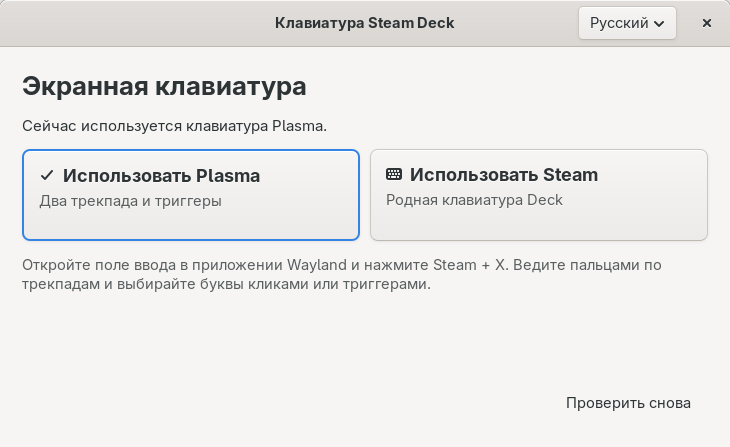

# Plasma Keyboard для Steam Deck

Независимый адаптер KDE Plasma Keyboard для настольного режима Steam Deck. Набирайте текст двумя трекпадами с тактильным откликом и подсказками на русском и английском. Клавиатуру открывают **X** и **Steam + X**.

[Скачать для Steam Deck](https://github.com/YaziAranea/steam-deck-plasma-keyboard/archive/refs/heads/main.tar.gz). В режиме рабочего стола распакуйте архив и откройте **Steam Deck Keyboard.desktop**. Затем менеджер можно открыть из меню приложений по названию **Клавиатура Steam Deck**.

| Действие | Управление |
| --- | --- |
| Открыть или скрыть клавиатуру | Нажать **X** или **Steam + X** в текстовом поле. Следующее нажатие скрывает панель и возвращает правому трекпаду управление мышью |
| Отредактировать выделенный текст | Нажать **X**, затем выбрать букву для замены или **⌫** для удаления. Отдельная **X** действует, когда на неё назначен штатный показ клавиатуры в настольной раскладке Steam |
| Навести на букву | Провести пальцем по левому или правому трекпаду. Цветная подсказка показывает выбранную клавишу |
| Ввести букву | Щёлкнуть этим трекпадом или нажать **L2** для левого, **R2** для правого, сохраняя касание |
| Стереть текст | Коротко нажать **B** или выбрать **⌫**, чтобы стереть один символ либо выделение. Удержание запускает повтор через 450 мс, затем каждые 75 мс |
| Скрыть клавиатуру в пустом поле | Нажать **B**. Если осталась одна буква, первое нажатие стирает её, второе скрывает панель. Удержание **B** стирает текст и скрывает панель. Экранная **⌫** оставляет клавиатуру открытой |
| Дополнить слово | Начать слово на русском или английском и выбрать подсказку сверху трекпадом или касанием |
| Сменить язык клавиатуры | Выбрать клавишу с глобусом |
| Ввести касанием экрана | Коснуться клавиши на экране |

При наведении трекпад даёт короткий импульс. Если плавно усилить нажим, сначала появится мягкий отклик. Когда сработает клавиша, трекпад даст отдельный щелчок. Его сила зависит от давления этого пальца в момент нажатия и в следующие 8 мс. Более сильному нажатию соответствует более длинная серия импульсов. Удержание буквы не повторяет ввод. После отпускания ту же клавишу можно сразу нажать снова.

Точка под пальцем растёт вместе с давлением. Подсказка белеет при вводе и возвращает цвет при отпускании. Совместное нажатие трекпада и соответствующего триггера вводит одну букву. Адаптер читает настройку тактильного отклика клавиатуры Steam при каждом открытии панели, включая выключенный отклик.

Подсказки появляются после двух букв и предлагают до трёх продолжений. Выбор дописывает окончание слова у курсора. В комплекте по 30 000 слов для каждого языка. Поиск работает на устройстве. [Источники словарей и лицензия](src/words/NOTICE.md)

## Установка

Нужны настольный сеанс KDE Plasma **Wayland**, Steam, подключённый встроенный контроллер и системный пакет Plasma Keyboard. Для ввода в приложении нужна поддержка экранной клавиатуры Wayland. Основной сценарий проверялся с русским и английским вводом в Codex. Установщик работает от обычного пользователя. [Пошаговая установка](INSTALL.md)

При первом включении Plasma менеджер поможет связать клавиатуру с шаблоном управления Steam. В дальнейшем в том же окне можно переключаться между Plasma и родной клавиатурой Steam. Профиль и настройки адаптера сохраняются.

Пока панель открыта, Steam использует отдельный профиль для трекпадов и триггеров. Для стирания адаптер занимает B только при штатном назначении Escape. Задние кнопки наследуются из вашей настольной раскладки. После закрытия панели Steam возвращается к обычному управлению.

## Авторы и лицензии

Клавиатуру и исходные раскладки предоставляет установленный пакет [KDE Plasma Keyboard](https://github.com/KDE/plasma-keyboard). Этот проект добавляет управление Deck, обработку силы нажатия, управление режимами, строку подсказок и графический установщик. Собственный код адаптера и менеджера распространяется по [лицензии MIT](LICENSE).

Списки русских и английских слов подготовлены из FrequencyWords и распространяются по CC BY-SA 4.0. У KDE, Qt и их раскладок сохраняются исходные лицензии. [Источники словарей, изменения и условия](src/words/NOTICE.md).

## Удаление

Из каталога проекта выполните `python3 setup.py remove`. Затем удалите из библиотеки Steam служебный ярлык **Deck Plasma Keyboard Controls**. [Восстановление настроек и обновление](INSTALL.md#удаление)
